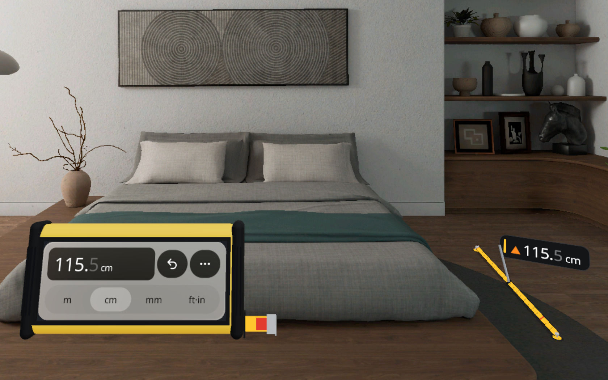
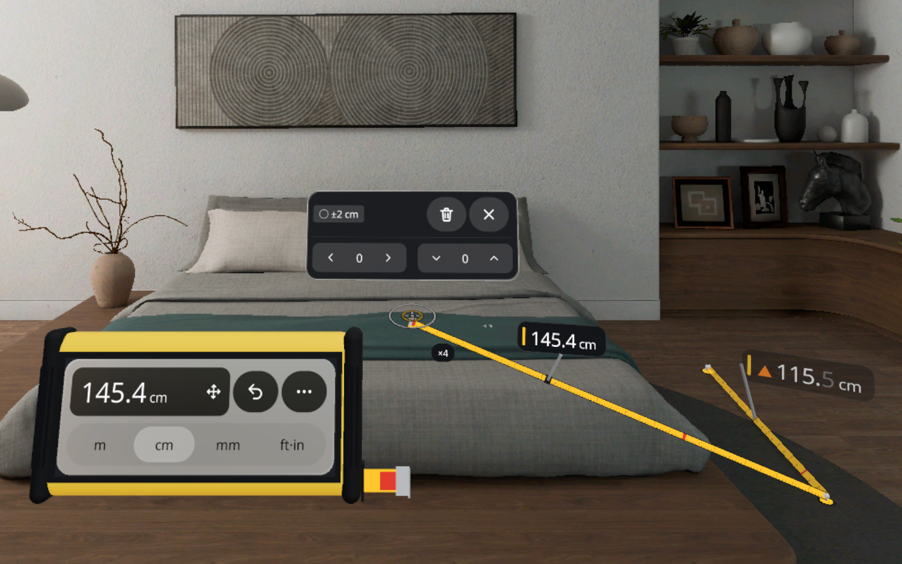

# 空间尺 Spatial Ruler

PICO OS 6 上的 MR 测距应用。在真实表面上落下测量钉，任意两颗钉之间拉出一条按 1 : 1 刻度印好的卷尺，读数牌骑在尺带上，每个读数都带着这次测量的公差。钉就是空间锚点：退出再打开，钉和尺还在原处。

An MR measuring app for PICO OS 6 (Full Space, one Mixed Stage). Set pins on real surfaces and pull a tape between any two of them: the blade is printed at true scale, a reading plate rides on it, and every reading carries its tolerance. Pins are spatial anchors, so pins and tapes are back in place when you reopen the app.





Demo video: [docs/media/SpatialRuler-demo.mp4](docs/media/SpatialRuler-demo.mp4)

## 怎么用 How it works

房间里只有钉、尺带和视野左下角的黄色尺身。Pins, tapes and a yellow instrument body at the lower left of your view; nothing else floats in the room.

- **点—点 Tap–tap**：对准一个点捏合（手柄：扣扳机）落第一颗钉，再点第二个点，尺带拉过去、刻度展开、读数从 0 数上来。也可以在表面上按住直接拖出一条尺。Pinch at a point to set a pin, pinch at a second point and the tape pulls across; or press and drag on a surface to pull a tape out live.
- **任意两钉 Any two pins**：点一颗已有的钉，它到其余各钉的距离以虚线和距离片亮出；再点另一颗钉或距离片，两钉之间拉出一条尺。Tap a pin to see its distances to the others, then tap another pin or a chip.
- **拖动微调 Drag to adjust**：按住钉拖动，连着的尺和读数实时变化；手停下约 0.4 s 后自动 1 : 4 细调（准星旁 ×4），一动快就回到 1 : 1。钉条上的 ‹ › ˅ ˄ 每格 1 mm。Drag a pin; hold still and the gain drops to 1 : 4. The chevrons on its strip step 1 mm.
- **读数 Readings**：◆ 触测 / ● 细瞄 / ○ 粗瞄；末位变淡表示精度到不了那一位，▲ 表示超过 3 m 或未保存；点读数牌或钉可以看到 ±。Dimmed digits show the precision; tap a plate or a pin for the exact ±.
- **单位与语言 Units and language**：尺身上的分段切 m / cm / mm / ft·in；⋯ 菜单里切 跟随系统 / 中文 / EN、开关吸附、全部清除、退出。撤销在尺身上（最近 20 步）。Units sit on the body; language, snap, Clear all and Exit are in the ⋯ menu.

## 技术 Tech

- PICO Spatial SDK 6.1.9, Kotlin; one Mixed Stage in Full Space; package `io.embodit.spatialruler`.
- All 2D UI is SpatialUI (`com.pico.spatial.ui.*`) wrapped in `PicoTheme`, icons over words. No Material.
- 3D runtime in ECS: pins, tapes, reticle and body are entities, and all per-frame work runs in one registered `System` (`RulerScene`). Panels come from a pool of 35 pre-built attachment panels.
- Pure-Kotlin domain (`domain/`, no SDK types): the state machine, aiming, snapping, tolerance, reading format and head-relative layout. 254 JVM unit tests.
- Bundled fonts: Noto Sans (Latin and figures) and a Noto Sans SC subset (265 characters).

## 构建 Build

```bash
./gradlew assembleDebug :app:testDebugUnitTest
adb install -r app/build/outputs/apk/debug/app-debug.apk
adb shell am start -n io.embodit.spatialruler/.platform.LaunchActivity
```

Needs the PICO Spatial SDK (`PICO_HOME`) and JDK 21. `tools/dev.sh` (Git Bash) wraps the same steps and the validation gates; its device commands are pinned to `emulator-5556`. Verified on the PICO 6.1 emulator; not yet run on a headset.

## 文档 Docs

- [docs/PRD.md](docs/PRD.md): product requirements.
- [design/design-doc.md](design/design-doc.md) and [design/preview.html](design/preview.html): the design package (frame, three directions, plan, critique). The preview is a logic and layout reference and was not rebuilt after the reviews.
- [docs/review/](docs/review/): design reviews 1 and 2, and the icon-first simplify spec, which wins over the design doc where they disagree.
- [docs/test/](docs/test/): QA reports, rounds 1 – 5c.
- [docs/DEMO.md](docs/DEMO.md): how to try it in the emulator.
- [AGENTS.md](AGENTS.md): guidance for coding agents: structure, runtime facts learned on the emulator, debug commands.
- Figma: https://www.figma.com/design/x5myBFklw420gFWSYCDanU (01 产品定义 / 02 空间布局 / 03 关键画面 / 04 组件规范)

## 字体 Font

Bundled fonts, both under the SIL Open Font License 1.1:

- Noto Sans (Regular, Medium, SemiBold, Bold): `third_party/noto-sans/OFL.txt`.
- Noto Sans SC, subset from the variable font to 265 characters (a Modified Version under the OFL): `third_party/noto-sans-sc/OFL.txt`, with the subset notes in `third_party/noto-sans-sc/SUBSET.txt`.
